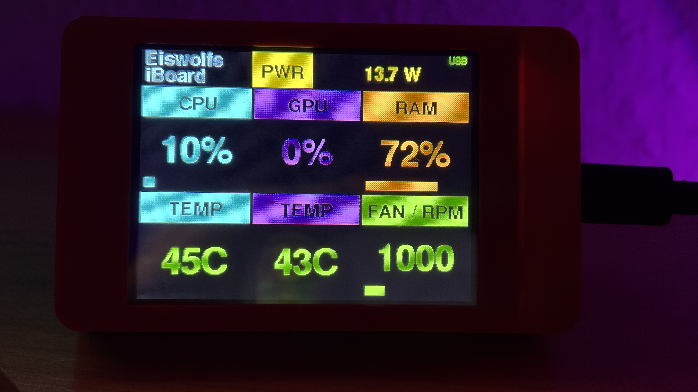

# Eiswolfs iBoard

A small desktop dashboard for your Mac: a Mac mini (Apple Silicon)
sends its live system stats over WiFi to a classic "Cheap Yellow
Display" (CYD, ESP32-2432S028), which shows them on a little stand next
to your desk. The CYD only needs USB power to run; it's connected to
the Mac via USB only while flashing.

**Open source under the [MIT License](LICENSE).**

## Features

- **Six live tiles**: CPU load, GPU load, RAM usage, CPU temperature,
  GPU temperature, fan speed - each with its own color-coded stripe and
  a live bar graph. This main screen is a pure display - swipe left to
  reach the **Controls** screen for everything below (swipe right to
  come back).
- **Menu bar app** (macOS, Apple Silicon only): reads CPU/RAM/disk via
  `psutil` and CPU/GPU temperature, GPU load, power draw, and fan speed
  via the bundled [macmon](https://github.com/vladkens/macmon) tool -
  no `sudo` required. Shows your choice of value right in the menu bar
  icon.
  - Fan boost: temporarily push the fan to a fixed speed from the Mac
    menu or by tapping the Fan tile on the Controls screen - needs a
    small, optional [root helper](tools/fan-helper/README.md) (included
    in this repo, one `sudo bash install.sh` away).
  - Sleep: tap the Mac tile on the Controls screen (or use "Sleep now"
    in the Mac menu) to put the Mac mini straight to sleep - no need to
    reach for the keyboard. After the sleep triggered via the Mac Mini
    M4 tile, the display turns off and comes back on by itself once the
    Mac wakes up again. The Mac app pauses sending entirely during
    system sleep and even during a brief "DarkWake" (the Mac
    momentarily coming back online with the screen still off), so a
    single stray packet never turns the display back on by itself -
    the CYD only lights up once real data keeps arriving continuously.
    The "No connection to Mac" screen has its own Wake-on-LAN/shutdown
    button for every configured device too, so you can start one
    without waking the Mac at all.
- **Wake (and shut down) up to 4 devices over the network**: tap a
  device's tile to wake it (plain Wake-on-LAN, nothing to install),
  long-press to shut it down (needs the small optional [Windows
  listener](windows/README.md) on that machine, and the machine's IP
  address entered for it - skippable if you only want wake-up).
  Managed on the CYD itself under menu → Setup → "WoL devices": add,
  rename or delete entries, each gets its own colour. The first device
  stays pinned to the Controls screen's top-left tile; a second "Devices"
  screen (swipe left from Controls) appears automatically once you have
  more than one. For a new Windows laptop: install the Windows listener,
  enable Wake-on-LAN in both its BIOS/UEFI and network adapter settings,
  prefer a wired connection (WiFi adapters often don't wake from a fully
  powered-off state), and give it a static IP in your router if you want
  to shut it down remotely too (its IP can change otherwise). Full
  step-by-step walkthrough: [docs/WOL_SETUP.md](docs/WOL_SETUP.md).
- **Alexa (optional, off by default)**: say "Alexa, turn on Laptop" to
  wake the first WoL device. Switched on under menu → Setup → "Alexa",
  where you can also change the name; while it is off no service runs
  and no port is open. See the [guide](docs/ANLEITUNG.en.md#10-alexa).
- **Two connection paths at once**: the same data goes out over WiFi
  (UDP broadcast + unicast) and over a USB serial line simultaneously -
  the CYD picks whichever is fresher (configurable: auto/USB-only/
  WiFi-only).
- **Two switchable display fonts** ("Pixel" retro bitmap font or a
  clean sans-serif), a boot screen, and a simple on-device menu for
  WiFi setup, font choice, display brightness, and the menu-bar value
  picker. The WiFi network list (menu → Setup → "Change WiFi only")
  has a back arrow top-left to return to the menu without touching the
  saved network.
- **Bilingual, German/English**: a one-tap switch in the on-device menu
  and in the Mac app's menu bar, chosen during first-time setup on the
  CYD.
- **Celsius/Fahrenheit**: switchable in the Mac app's menu bar.

## Web installer

Install both halves straight from the browser:
[**eiswolf-bg.github.io/Eiswolfs-iBoard-CYD**](https://eiswolf-bg.github.io/Eiswolfs-iBoard-CYD/)
- flashes the CYD firmware via Web Serial (Chrome/Edge/Opera), and links
  to the latest Mac app `.dmg`.

## Step-by-step guide

New to this? The beginner guide walks through everything - what you
need, flashing the CYD, WiFi and first setup, the Mac app, the shared
key, a fixed IP in the router, Wake-on-LAN, the Windows listener,
monitor switching, Alexa, a troubleshooting table and security notes:

- [docs/ANLEITUNG.en.md](docs/ANLEITUNG.en.md) (English)
- [docs/ANLEITUNG.de.md](docs/ANLEITUNG.de.md) (Deutsch)

**Short version:** (1) flash the CYD with the web installer, (2) on its
first start calibrate the touch and pick your 2.4 GHz home WiFi, (3)
install the Mac app from the `.dmg` - the Mac's values show up on the
display. Everything else (waking and shutting down a laptop, monitor
switching, Alexa) is optional.

## Installation

Easiest: use the [web installer](https://eiswolf-bg.github.io/Eiswolfs-iBoard-CYD/)
above for both halves. Details and alternative methods:

- **Mac app**: see
  [mac/dmg_staging/INSTALLATION.md](mac/dmg_staging/INSTALLATION.md)
  (or the same file bundled inside the DMG) for installing from the
  `.dmg` in a [release](../../releases), granting the Gatekeeper/
  local-network permissions, and setting up autostart.
- **CYD firmware**: see [dist/FLASHEN.md](dist/FLASHEN.md) (or the
  copy attached to each [release](../../releases)) for flashing with
  a generic tool or `esptool` from the command line, no software
  install needed either way.
- **Windows listener** (optional, only for shutting down a Windows
  laptop from the CYD): see [windows/README.md](windows/README.md).
- **Fan helper** (optional, only for fan boost): see
  [tools/fan-helper/README.md](tools/fan-helper/README.md) - what it
  does, why it needs root, and the one-line install.

The Mac app, the CYD firmware, and (if you use it) the Windows listener
all need a matching **shared secret token** to unlock the optional
fan-boost/sleep/shutdown extras - see [docs/TOKEN.md](docs/TOKEN.md)
for exactly what it is and how to set it. Without it, those features
simply do nothing (or show "not available") while the core dashboard
works normally. Wake-on-LAN itself needs no token - it's a plain
network wake-up packet with no concept of authentication.

## Building from source

See [docs/DEVELOPMENT.md](docs/DEVELOPMENT.md) for build commands for
all three components (CYD firmware, Mac app, Windows listener).

## License

Eiswolfs iBoard is open source under the [MIT License](LICENSE)
(Copyright (c) Eiswolf-BG). You may use, copy, modify and share it,
including commercially, as long as the license text stays with it.

### Third-party components

Eiswolfs iBoard builds on other open-source software that keeps its own
license (a few parts are LGPL, notably the ESP32 Arduino core and the
AsyncTCP library). See [THIRD-PARTY-LICENSES.md](THIRD-PARTY-LICENSES.md) for every
open-source component used across all three parts of the project
(firmware libraries, bundled [macmon](https://github.com/vladkens/macmon),
Python packages, Go modules, fonts, the web installer) with full
license texts in [`licenses/`](licenses/).

## Not affiliated with Apple, Microsoft, or anyone else named here

This is an unofficial hobby project. "Mac", "Windows", and any other
product or company names mentioned are trademarks of their respective
owners — Eiswolfs iBoard isn't made, reviewed, or endorsed by any of
them. Provided as-is, no warranty — see [LICENSE](LICENSE).
