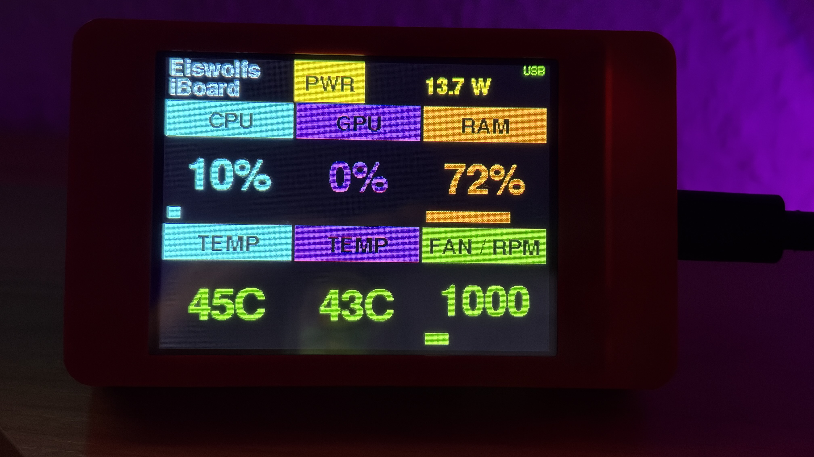

# Eiswolfs iBoard

A small desktop dashboard for your Mac: a Mac mini (Apple Silicon)
sends its live system stats over WiFi to a classic "Cheap Yellow
Display" (CYD, ESP32-2432S028), which shows them on a little stand next
to your desk. The CYD only needs USB power to run; it's connected to
the Mac via USB only while flashing.

**Private use only - see [LICENSE.md](LICENSE.md).**

## Features

- **Six live tiles**: CPU load, GPU load, RAM usage, CPU temperature,
  GPU temperature, fan speed - each with its own color-coded stripe and
  a live bar graph.
- **Menu bar app** (macOS, Apple Silicon only): reads CPU/RAM/disk via
  `psutil` and CPU/GPU temperature, GPU load, power draw, and fan speed
  via the bundled [macmon](https://github.com/vladkens/macmon) tool -
  no `sudo` required. Shows your choice of value right in the menu bar
  icon.
  - Fan boost: temporarily push the fan to a fixed speed from the Mac
    menu or by holding the FAN tile on the CYD - needs a small,
    optional, separately-installed root helper (`tools/fan-helper/`).
  - Sleep: tap the PWR tile on the CYD (or use "Sleep now" in the Mac
    menu) to put the Mac mini straight to sleep - no need to reach for
    the keyboard.
- **Two connection paths at once**: the same data goes out over WiFi
  (UDP broadcast + unicast) and over a USB serial line simultaneously -
  the CYD picks whichever is fresher (configurable: auto/USB-only/
  WiFi-only).
- **Two switchable display fonts** ("Pixel" retro bitmap font or a
  clean sans-serif), a boot screen, and a simple on-device menu for
  WiFi setup, font choice, display brightness, and the menu-bar value
  picker.
- **Bilingual, German/English**: a one-tap switch in the on-device menu
  and in the Mac app's menu bar, chosen during first-time setup on the
  CYD.
- **Celsius/Fahrenheit**: switchable in the Mac app's menu bar.

## Web installer

Install both halves straight from the browser:
[**eiswolf-bg.github.io/Eiswolfs-iBoard-CYD**](https://eiswolf-bg.github.io/Eiswolfs-iBoard-CYD/)
- flashes the CYD firmware via Web Serial (Chrome/Edge/Opera), and links
  to the latest Mac app `.dmg`.

## Installation

Easiest: use the [web installer](https://eiswolf-bg.github.io/Eiswolfs-iBoard-CYD/)
above for both halves. Details and alternative methods:

- **Mac app**: see
  [mac/dmg_staging/INSTALLATION.md](mac/dmg_staging/INSTALLATION.md)
  (or the same file bundled inside the DMG) for installing from the
  `.dmg` in a [release](../../releases), granting the Gatekeeper/
  local-network permissions, and setting up autostart.
- **CYD firmware**: see [dist/FLASHEN.md](dist/FLASHEN.md) (or the
  copy attached to each [release](../../releases)) for flashing with
  a generic tool or `esptool` from the command line, no software
  install needed either way.

Both the Mac app and the CYD firmware need a matching **shared secret
token** to unlock the optional fan-boost/sleep extras; without it,
those two features simply show "not available" while the core
dashboard works normally.

## Building from source

- **Mac app**: PyInstaller, see `mac/eiswolfs_iboard.spec` and the
  build notes in `CLAUDE.md`.
- **CYD firmware**: PlatformIO (`cd cyd && pio run`), targets the
  classic CYD (ESP32-2432S028, resistive touch).

## Third-party components

See [mac/dmg_staging/THIRD-PARTY-LICENSES.md](mac/dmg_staging/THIRD-PARTY-LICENSES.md)
for the bundled [macmon](https://github.com/vladkens/macmon) tool (MIT)
and the Python packages used to build the Mac app.
