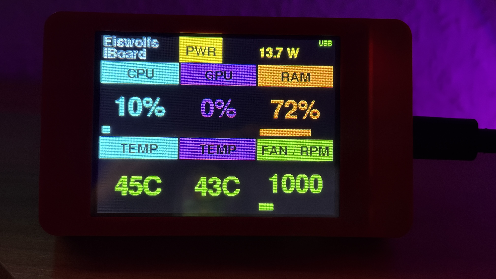
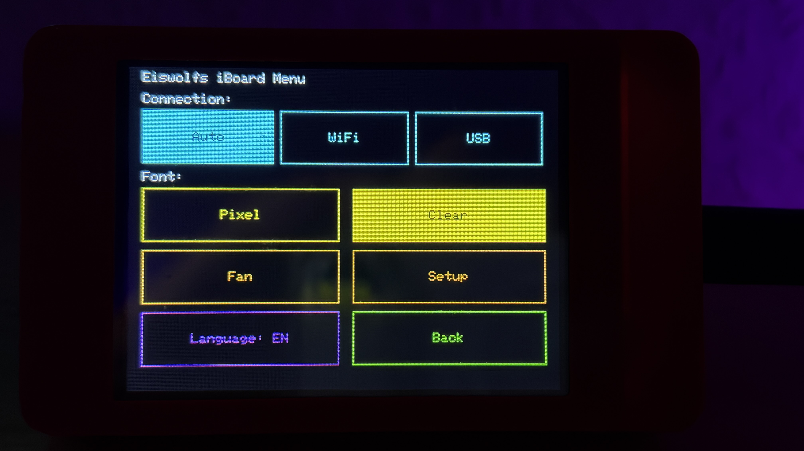
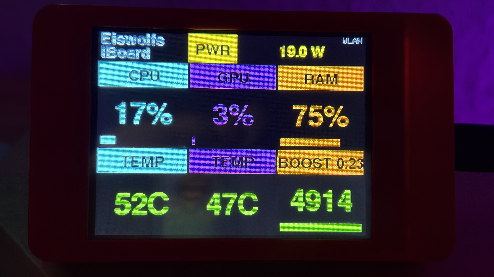
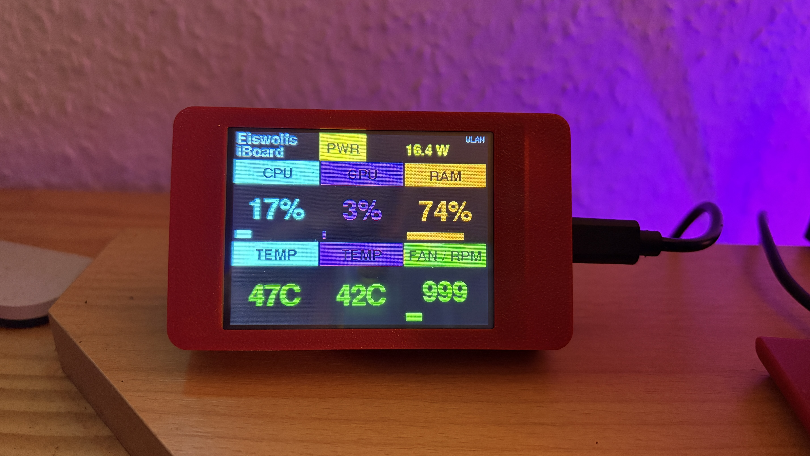

# 📷 Photo Gallery

A few more photos of Eiswolfs iBoard in action.

[← Back to README](../README.md)

---

**Dashboard** – CPU, GPU, RAM, CPU temperature, GPU temperature, and fan speed at a glance.

---

**Menu** – connection path, display font, fan boost, setup, and a
one-tap language switch (German/English).

---

**Fan boost** – temporarily pushed to a fixed speed, with a live
countdown on the RAM/boost tile.

---

**On the desk** – the CYD next to the Mac mini it's reporting on.
